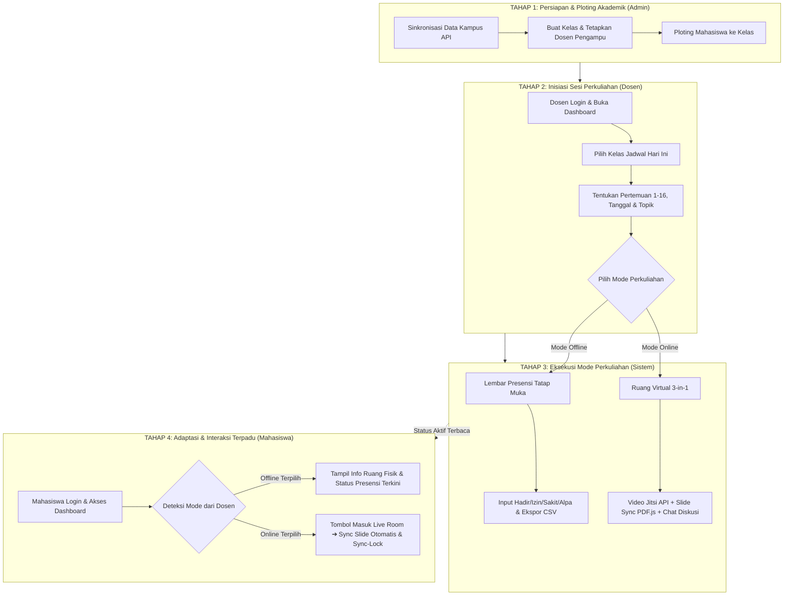

# Dokumen Alur Sistem 4 Tahap: Platform Virtual Classroom 3-in-1

Dokumen ini disusun sebagai panduan resmi dan ringkas untuk menjelaskan arsitektur alur kerja (*system flow*) aplikasi **Virtual Classroom 3-in-1 Berbasis Single-Window Interface**. Dokumen ini dirancang agar mudah dipahami oleh penguji, dosen pembimbing, maupun pengembang teknis.

---

## 1. Diagram Alur Utama (4 Tahap)

---

## 2. Rincian 4 Tahap Alur Sistem

### 🔹 TAHAP 1: Persiapan & Ploting Akademik (Administrator)
* **Tujuan**: Membangun relasi data akademik yang valid sebelum perkuliahan dapat dimulai.
* **Aktivitas Utama**:
  1. **Sinkronisasi Master Data**: Mengambil data Program Studi, Dosen, Mahasiswa, dan Mata Kuliah melalui integrasi API Kampus atau data mock.
  2. **Pembuatan Kelas Perkuliahan**: Admin membuat record kelas (`CourseClass`) dengan menetapkan mata kuliah, dosen pengampu, semester aktif, hari, jam, dan ruangan fisik.
  3. **Ploting Peserta**: Admin mendaftarkan mahasiswa ke dalam kelas (`course_class_students`).
* **Hasil (Output)**: Setiap dosen dan mahasiswa memiliki daftar kelas perkuliahan yang valid sesuai beban akademiknya.
* **Lokasi Koding Terkait**:
  - Controller: [`AdminCourseClassController.php`](file:///c:/laragon/www/project-3in1/app/Http/Controllers/AdminCourseClassController.php) & [`CampusDataController.php`](file:///c:/laragon/www/project-3in1/app/Http/Controllers/CampusDataController.php)
  - Tampilan (Blade): [`admin/classes/plotting.blade.php`](file:///c:/laragon/www/project-3in1/resources/views/admin/classes/plotting.blade.php)

---

### 🔹 TAHAP 2: Inisiasi Sesi Perkuliahan (Dosen)
* **Tujuan**: Dosen membuka sesi perkuliahan resmi sesuai jadwal dan menentukan bentuk pelaksanaan kuliah pada hari tersebut.
* **Aktivitas Utama**:
  1. Dosen masuk ke Dashboard, sistem otomatis menyaring kelas berdasarkan **semester aktif berjalan**.
  2. Dosen memilih kartu kelas yang ditugaskan kepadanya dan menekan tombol **"Atur & Mulai Perkuliahan"**.
  3. Pada form setup sesi, sistem secara otomatis merekomendasikan:
     - Nomor pertemuan berikutnya (1 s/d 16).
     - Tanggal pelaksanaan hari ini.
     - Form input topik / materi pembahasan.
  4. Dosen menentukan **Mode Perkuliahan**:
     - **Mode Online (Daring)**: Menggunakan kelas virtual 3-in-1.
     - **Mode Offline (Tatap Muka)**: Menggunakan lembar presensi fisik.
* **Hasil (Output)**: Record sesi tersimpan di tabel `course_lecture_sessions` dan status perkuliahan aktif dimulai.
* **Lokasi Koding Terkait**:
  - Controller: [`DosenLectureSessionController.php`](file:///c:/laragon/www/project-3in1/app/Http/Controllers/Dosen/DosenLectureSessionController.php) (`setup`, `store`)
  - Tampilan (Blade): [`dosen/classes/session_setup.blade.php`](file:///c:/laragon/www/project-3in1/resources/views/dosen/classes/session_setup.blade.php)

---

### 🔹 TAHAP 3: Eksekusi Mode Perkuliahan (Percabangan Sistem)
Sistem melakukan percabangan alur berdasarkan mode yang dipilih oleh dosen pada Tahap 2:

#### Jalur A: Mode Offline / Tatap Muka
1. Dosen otomatis diarahkan ke **Lembar Presensi Tatap Muka** (`/dosen/lectures/{id}/attendance`).
2. Seluruh mahasiswa kelas langsung terdaftar di tabel presensi (`course_lecture_attendances`).
3. Dosen dapat:
   - Menggunakan tombol 1-klik **"Tandai Semua Hadir"**.
   - Mengubah status per mahasiswa menjadi `Hadir`, `Izin`, `Sakit`, atau `Alpa`.
   - Menambahkan catatan dispensasi/keterangan (misal: *Surat dokter*).
   - Mengunduh rekap presensi terformat ke dalam file **CSV** untuk berita acara perkuliahan (BAP).
* **Lokasi Koding**: [`DosenLectureSessionController.php`](file:///c:/laragon/www/project-3in1/app/Http/Controllers/Dosen/DosenLectureSessionController.php) (`showAttendance`, `saveAttendance`, `exportAttendanceCsv`) & [`dosen/lectures/attendance.blade.php`](file:///c:/laragon/www/project-3in1/resources/views/dosen/lectures/attendance.blade.php).

#### Jalur B: Mode Online / Daring (Single-Window Interface 3-in-1)
1. Dosen dan mahasiswa diarahkan ke **Ruang Kelas Virtual** (`/room/{room_code}`).
2. Tiga media pembelajaran disatukan ke dalam **satu tampilan antarmuka (single-page)**:
   - **Layanan Tatap Muka Video**: Menggunakan SDK resmi Jitsi Meet External API dengan toolbar kendali kamera, mic, dan share screen.
   - **Penampil Dokumen Interaktif & Sinkronisasi**: Dosen mengunggah materi (PDF/PPT/PPTX). Saat dosen mengganti halaman slide, slide pada layar mahasiswa berpindah secara otomatis melalui mekanisme polling real-time.
   - **Papan Diskusi & Rekam Jejak**: Papan chat permanen tersimpan di database, fitur angkat tangan (*raise hand*), pembisuan massal (*mute all* oleh host), serta ekspor riwayat chat dan absensi online ke CSV.
* **Lokasi Koding**: [`VirtualClassroomController.php`](file:///c:/laragon/www/project-3in1/app/Http/Controllers/VirtualClassroomController.php) & [`classroom/room.blade.php`](file:///c:/laragon/www/project-3in1/resources/views/classroom/room.blade.php).

---

### 🔹 TAHAP 4: Adaptasi Antarmuka & Interaksi Terpadu (Mahasiswa)
* **Tujuan**: Memastikan mahasiswa selalu mendapatkan informasi perkuliahan yang sinkron dengan keputusan dosen tanpa kebingungan teknis.
* **Aktivitas Utama**:
  1. Mahasiswa login dan membuka Dashboard.
  2. Kartu kelas mahasiswa **beradaptasi otomatis**:
     - **Jika Dosen membuka sesi OFFLINE**: Tampil badge `🏫 KULIAH TATAP MUKA`, informasi ruang kelas fisik kampus, topik materi, serta **status kehadiran diri sendiri** yang dicatat dosen (Hadir / Izin / Sakit / Alpa).
     - **Jika Dosen membuka sesi ONLINE**: Tampil badge berkedip `🔴 KELAS SEDANG LIVE` dan tombol instan **"Masuk ke Kelas"** untuk bergabung ke ruang virtual 3-in-1.
  3. **Navigasi Mandiri (Fitur Sync-Lock di Kelas Online)**:
     - Slide mahasiswa secara *default* terkunci mengikuti layar dosen (*Auto-Sync*).
     - Jika mahasiswa ingin membaca ulang slide sebelumnya tanpa mengganggu jalannya kelas, mahasiswa dapat mematikan tombol gembok (**Sync-Lock**), lalu menekan tombol *"Ikuti Dosen"* untuk kembali tersinkronisasi.
* **Hasil (Output)**: Transparansi status perkuliahan dan pengalaman belajar daring yang minim beban operasional (*low cognitive load*).
* **Lokasi Koding Terkait**:
  - Dashboard Mahasiswa: [`VirtualClassroomController@mahasiswaDashboard`](file:///c:/laragon/www/project-3in1/app/Http/Controllers/VirtualClassroomController.php#L145) & [`mahasiswa/dashboard.blade.php`](file:///c:/laragon/www/project-3in1/resources/views/mahasiswa/dashboard.blade.php)
  - Fitur Sync-Lock: Script `#sync-lock-btn` pada [`classroom/room.blade.php`](file:///c:/laragon/www/project-3in1/resources/views/classroom/room.blade.php#L720)

---

## 3. Matriks Peran & Tanggung Jawab Sistem

| Komponen | Administrator | Dosen | Mahasiswa |
| :--- | :--- | :--- | :--- |
| **Data Master & Ploting** | Pengelola Penuh (CRUD & API) | Hanya membaca kelas plotting | Hanya membaca kelas terdaftar |
| **Inisiasi Sesi** | Tidak terlibat | Menentukan Pertemuan & Mode | Menunggu sesi dibuka dosen |
| **Presensi Tatap Muka** | Melihat rekapitulasi | Mengisi & Mengunduh CSV | Memantau status kehadiran mandiri |
| **Kontrol Slide Presentasi** | Tidak terlibat | Presenter / Pengendali Utama | Peserta (Sync otomatis / Sync-Lock) |
| **Video Conference** | Tidak terlibat | Host / Kontrol Mute All | Peserta (Mic, Kamera, Raise Hand) |
| **Papan Diskusi (Chat)** | Tidak terlibat | Mengirim chat & unduh log CSV | Mengirim chat & diskusi aktif |

---

## 4. Keunggulan Sistem untuk Bahan Presentasi / Sidang

1. **Mengatasi Fragmentasi Media**: Menggabungkan video conference, materi dokumen, dan chat ke dalam 1 jendela browser tanpa perlu berpindah-pindah aplikasi pihak ketiga.
2. **Efisiensi Bandwidth Jaringan**: Slide presentasi dirender secara lokal oleh browser peserta menggunakan PDF.js, bukan melalui screen sharing video yang boros kuota dan rawan buram.
3. **Mendukung Fleksibilitas Hybrid**: Tidak hanya melayani perkuliahan daring, tetapi juga memfasilitasi perkuliahan luring melalui manajemen lembar presensi digital terpadu.
4. **Verifikasi Kualitas Perangkat Lunak**: Seluruh logika alur di atas telah diverifikasi secara ketat melalui **82 skenario automated tests PHPUnit** dengan tingkat kelulusan 100%.
