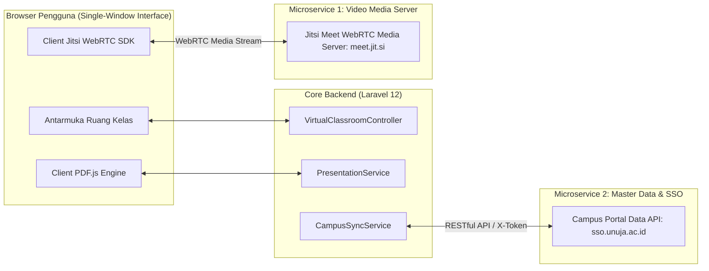
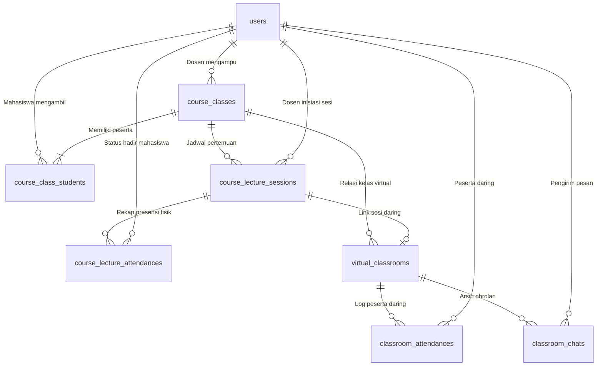
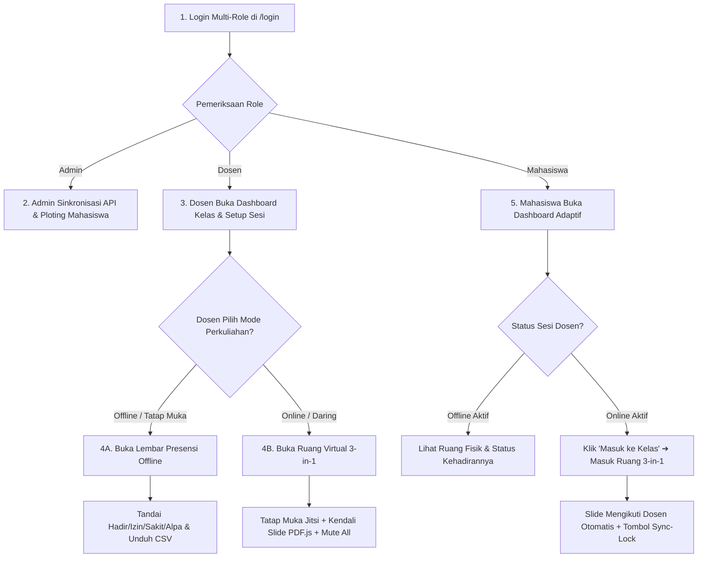

# Panduan Tanya Jawab Teknis Sidang & Presentasi
## Platform Virtual Classroom 3-in-1 Berbasis Single-Window Interface

Dokumen ini disusun khusus sebagai pegangan teknis dan skrip jawaban siap pakai bagi pengembang (**Muhammad Badir & Muhammad Hasan Al-Farisi** - Fakultas Teknik Universitas Nurul Jadid) dalam menghadapi pertanyaan dosen penguji atau pembimbing terkait 3 pilar utama arsitektur sistem: **Microservice**, **Skema Database**, dan **Alur Sistem (*Flow*)**.

---

## DAFTAR ISI
1. [Pertanyaan 1: Di Mana Letak Arsitektur Microservice pada Aplikasi?](#pertanyaan-1-di-mana-letak-arsitektur-microservice-pada-aplikasi)
2. [Pertanyaan 2: Bagaimana Rancangan Skema Database Sistem?](#pertanyaan-2-bagaimana-rancangan-skema-database-sistem)
3. [Pertanyaan 3: Bagaimana Alur (Flow) Kerja Sistem dari Awal Sampai Akhir?](#pertanyaan-3-bagaimana-alur-flow-kerja-sistem-dari-awal-sampai-akhir)

---

## PERTANYAAN 1: Di Mana Letak Arsitektur Microservice pada Aplikasi?

### A. Inti Konsep (Mental Model)
Aplikasi ini tidak dibangun sebagai *Full Internal Microservices* dari nol (yang memecah kode menjadi puluhan container server terpisah dengan biaya operasional tinggi), melainkan menerapkan pendekatan **Hybrid Architecture: Modular Monolith terintegrasi dengan Eksternal Microservices via REST API & WebRTC (Service-Oriented Architecture / SOA)**.

Inti manajemen perkuliahan dikelola oleh Laravel 12 secara terpusat, sementara komputasi berat dan layanan terdistribusi didelegasikan ke *microservices* terpisah.

### B. 4 Komponen Microservice / Service Terpisah & Lokasi Kodenya:

1. **Microservice Video Streaming (Jitsi Meet WebRTC Media Server)**:
   * **Fungsi**: Berdiri sendiri pada server cloud terpisah untuk menangani streaming audio/video real-time, WebRTC bridge, dan manajemen bandwidth tanpa membebani server utama Laravel.
   * **Lokasi Koding**:
     - Konfigurasi: [`config/services.php`](file:///c:/laragon/www/project-3in1/config/services.php#L54-L56) (`jitsi.domain`)
     - Integrasi SDK: [`resources/views/classroom/room.blade.php`](file:///c:/laragon/www/project-3in1/resources/views/classroom/room.blade.php#L800-L860)

2. **Microservice Master Data Akademik & SSO (Campus Data API)**:
   * **Fungsi**: Layanan RESTful terpisah milik universitas untuk menyediakan data master Program Studi, Dosen, Mahasiswa, Matakuliah, dan Jadwal secara aman menggunakan token otorisasi (`X-Token`, `dev_id`, `app_id`).
   * **Lokasi Koding**:
     - Konfigurasi: [`config/services.php`](file:///c:/laragon/www/project-3in1/config/services.php#L45-L52)
     - Konsumsi API: [`app/Services/CampusApiService.php`](file:///c:/laragon/www/project-3in1/app/Services/CampusApiService.php)
     - Sinkronisasi Data: [`app/Services/CampusSyncService.php`](file:///c:/laragon/www/project-3in1/app/Services/CampusSyncService.php)

3. **Service Layer Terisolasi Pemrosesan Dokumen (Document & Presentation Engine)**:
   * **Fungsi**: Memisahkan komputasi berat ekstraksi struktur XML presentasi PPTX dan konversi dokumen dari controller.
   * **Lokasi Koding**: [`app/Services/PresentationService.php`](file:///c:/laragon/www/project-3in1/app/Services/PresentationService.php).

4. **Micro-Endpoint State Synchronization Engine**:
   * **Fungsi**: Endpoint bertindak sebagai *message/state broker* ringan yang mendistribusikan data realtime (nomor slide, raise hand, status mic, dan chat) dalam format JSON ringan tiap 1.5–2 detik.
   * **Lokasi Koding**: Method `getRoomState` dan `updateSlide` pada [`VirtualClassroomController.php`](file:///c:/laragon/www/project-3in1/app/Http/Controllers/VirtualClassroomController.php).

### 🗣️ Skrip Jawaban Verbal untuk Penguji:
> *"Aplikasi kami menerapkan pendekatan **Hybrid Service-Oriented Architecture (SOA)**. Kami tidak memaksakan full microservices internal yang membutuhkan infrastruktur rumit, melainkan mendelegasikan tugas-tugas terdistribusi ke layanan eksternal independen:  
> 1. **Microservice Video Conference**: Menggunakan server WebRTC mandiri melalui Jitsi Meet External API SDK yang terpisah dari web server kami, sehingga lalu lintas video tidak membebani server aplikasi.  
> 2. **Microservice Data Kampus**: Mengonsumsi RESTful API Portal Data Kampus melalui `CampusApiService.php` untuk sinkronisasi mahasiswa, dosen, dan mata kuliah.  
> 3. **Service Layer Terisolasi**: Pemrosesan dokumen slide dipisahkan secara khusus pada `PresentationService.php`.  
> Pendekatan ini membuat sistem sangat scalable, hemat sumber daya komputasi, dan terhindar dari single point of failure."*

---

## PERTANYAAN 2: Bagaimana Rancangan Skema Database Sistem?

### A. Inti Konsep (Mental Model)
Skema database dibangun di atas **MySQL 8.0** dengan prinsip normalisasi relasional (3NF). Sistem memiliki keunggulan **Dual Attendance Engine** yang mampu menangani presensi daring (ruang virtual) maupun tatap muka (luring).

### B. Diagram Relasi Entitas (ERD):

### C. 7 Tabel Utama Sistem:

1. **`users`** ([`User.php`](file:///c:/laragon/www/project-3in1/app/Models/User.php)): Menyimpan data pengguna, NIDN/NIM (`username` unik), password bcrypt, peran (`admin`, `dosen`, `mahasiswa`), prodi, dan fakultas.
2. **`course_classes`** ([`CourseClass.php`](file:///c:/laragon/www/project-3in1/app/Models/CourseClass.php)): Menyimpan kelas perkuliahan resmi semester berjalan, kode MK, nama MK, SKS, dosen pengampu, hari, jam, dan ruangan fisik.
3. **`course_class_students`**: Tabel pivot Many-to-Many antara kelas dan mahasiswa dengan konstrain `unique(['course_class_id', 'student_id'])` agar mahasiswa tidak terdaftar dobel.
4. **`course_lecture_sessions`** ([`CourseLectureSession.php`](file:///c:/laragon/www/project-3in1/app/Models/CourseLectureSession.php)): Induk sesi pertemuan 1 s/d 16 yang menyimpan tanggal, topik, ruangan, dan mode perkuliahan (`online` atau `offline`).
5. **`course_lecture_attendances`** ([`CourseLectureAttendance.php`](file:///c:/laragon/www/project-3in1/app/Models/CourseLectureAttendance.php)): Lembar presensi tatap muka offline (status: `hadir`, `izin`, `sakit`, `alpa`) dilengkapi catatan dispensasi dan fitur ekspor CSV.
6. **`virtual_classrooms`** ([`VirtualClassroom.php`](file:///c:/laragon/www/project-3in1/app/Models/VirtualClassroom.php)): Menyimpan state kelas virtual daring (kode unik `room_code`, path materi presentasi, `current_slide`, `total_slides`, status `is_all_mic_muted`).
7. **`classroom_attendances` & `classroom_chats`**: Mencatat waktu join durasi kehadiran daring dan menyimpan riwayat pesan obrolan kelas secara permanen.

### 🗣️ Skrip Jawaban Verbal untuk Penguji:
> *"Skema database kami dirancang relasional dalam 3 kelompok: Pengguna, Akademik, dan Perkuliahan Hybrid.  
> Keunggulan arsitektural database kami ada pada **Dual Attendance Engine**:  
> Tabel `course_lecture_sessions` mengatur pertemuan 1 hingga 16. Jika dosen memilih mode **Offline**, data presensi dicatat pada tabel `course_lecture_attendances` dengan status akademik resmi (Hadir, Izin, Sakit, Alpa) dan catatan dispensasi yang bisa diekspor ke CSV. Jika memilih mode **Online**, sistem menghubungkannya ke tabel `virtual_classrooms` untuk sinkronisasi slide, tabel `classroom_attendances` untuk log kehadiran virtual, serta `classroom_chats` untuk arsip diskusi permanen.  
> Seluruh tabel dilindungi Foreign Key cascadeOnDelete dan unique index untuk menjamin tidak ada duplikasi absensi maupun data yatim (orphan data)."*

---

## PERTANYAAN 3: Bagaimana Alur (Flow) Kerja Sistem dari Awal Sampai Akhir?

### A. Inti Konsep (Mental Model)
Alur sistem dirancang untuk memecahkan masalah **fragmentasi media perkuliahan daring** (menyatukan video conference, penampil slide real-time, dan chat ke dalam *Single-Window Interface*) sekaligus **mendukung fleksibilitas perkuliahan tatap muka (luring)**.

### B. Diagram Alur Sistem (Flowchart):

### C. 5 Langkah Alur Operasional:
1. **Autentikasi Multi-Role**: Pengguna login menggunakan NIDN (Dosen) atau NIM (Mahasiswa). Sistem mengarahkan pengguna secara otomatis ke dashboard perannya masing-masing via middleware RBAC.
2. **Ploting Akademik (Admin)**: Admin menyinkronkan data dari API Kampus, membuat kelas mata kuliah, dan mendaftarkan mahasiswa peserta kelas.
3. **Inisiasi Sesi (Dosen)**: Dosen memilih kelas jadwalnya, menentukan nomor pertemuan (1–16) dan topik materi, lalu memilih mode: **Online** atau **Offline**.
4. **Eksekusi Percabangan Sistem**:
   - **Mode Offline**: Dosen diarahkan ke lembar presensi tatap muka digital. Semua mahasiswa kelas langsung terdaftar. Dosen dapat menggunakan tombol 1-klik *"Tandai Semua Hadir"*, mengubah status perorangan, memberi keterangan izin/sakit, dan mengunduh rekapan **CSV** untuk Berita Acara Perkuliahan (BAP).
   - **Mode Online**: Dosen dan mahasiswa masuk ke Ruang Kelas Virtual 3-in-1 (*Single-Window Interface*). Video conference Jitsi, slide materi PDF.js, dan papan chat tampil bersisian dalam satu layar.
5. **Adaptasi & Interaksi Mahasiswa**:
   - Jika dosen membuka sesi offline, kartu kelas mahasiswa menampilkan ruang fisik dan status absensinya.
   - Jika online, muncul tombol masuk live. Di dalam kelas daring, slide mahasiswa terkunci otomatis mengikuti dosen (*Auto-Sync*), namun mahasiswa memiliki tombol **Sync-Lock** untuk menelusuri slide materi secara mandiri dan tombol *"Ikuti Dosen"* untuk kembali sinkron.

### 🗣️ Skrip Jawaban Verbal untuk Penguji:
> *"Alur sistem kami terbagi menjadi 3 tahapan utama:  
> Pertama, **Tahap Persiapan (Admin)**: Admin menyiapkan kelas perkuliahan dan mem-ploting mahasiswa peserta kelas.  
> Kedua, **Tahap Inisiasi & Percabangan (Dosen)**: Dosen login, memilih kelas jadwalnya, menentukan pertemuan ke-1 sampai 16, lalu memilih mode perkuliahan:  
> * Jika memilih **Offline**, dosen masuk ke lembar presensi tatap muka untuk mencatat kehadiran (Hadir, Izin, Sakit, Alpa) dan mengunduh rekapan CSV untuk BAP.  
> * Jika memilih **Online**, sistem membuka ruang kelas virtual 3-in-1 yang menggabungkan video conference Jitsi, slide materi interaktif PDF.js, dan papan diskusi dalam satu layar tunggal.  
> Ketiga, **Tahap Adaptasi (Mahasiswa)**: Dashboard mahasiswa otomatis beradaptasi dengan keputusan dosen—menampilkan informasi ruang fisik dan status absensi jika offline, atau menyediakan akses instan ke ruang kelas daring dengan fitur sinkronisasi slide otomatis dan kontrol tombol Sync-Lock."*
